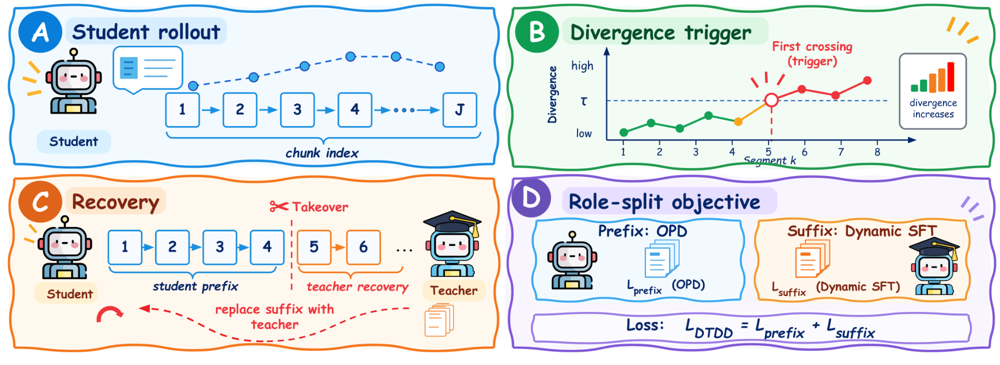
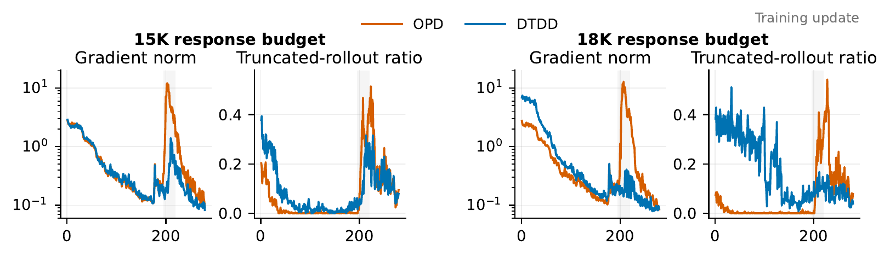
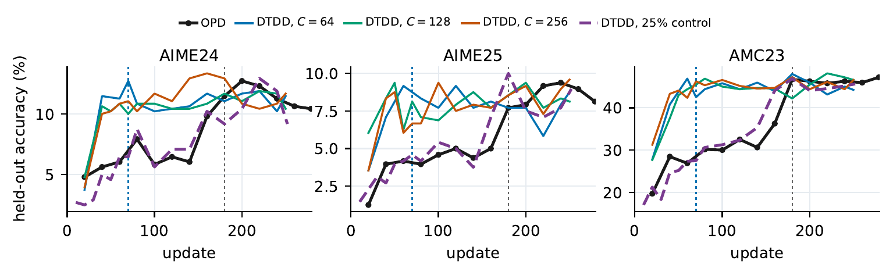
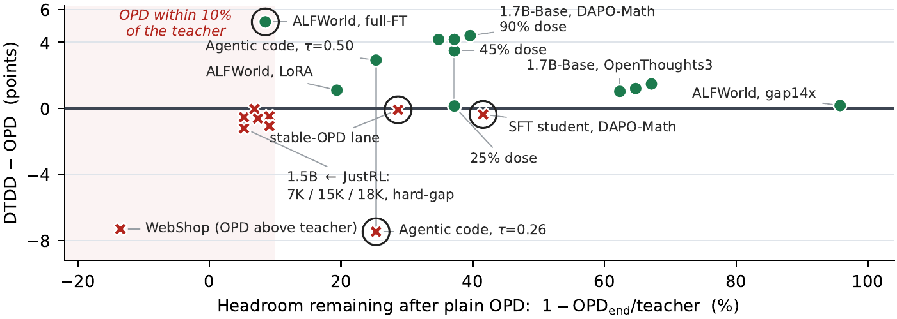

<div align="center">
  <h1>DTDD: Divergence-Triggered Dynamic Distillation<br>for Reliable On-Policy Supervision</h1>
</div>
<p align="center">
  <a href="LICENSE">
    
  </a>
  <a href="https://dtdd-proj.github.io/">
    
  </a>
  <a href="https://arxiv.org/abs/2610.19302">
    
  </a>
  <a href="#citation">
    
  </a>
</p>

<p align="center">
  
</p>

## Overview

On-policy distillation (OPD) supervises a student on its own rollouts with a
frozen teacher's per-token signal. That signal becomes unreliable once the
student drifts into states the teacher would never visit, which happens with a
large initial policy gap and with errors that compound over long generations
and multi-turn tool use.

DTDD monitors student–teacher divergence segment by segment while the student
generates. When a segment's divergence exceeds a threshold τ, the teacher takes
over from that point and writes the rest of the sequence. The student then
learns from both parts of one sequence: its own prefix through the standard OPD
signal, and the teacher's continuation through behaviour cloning.

This repository is a minimal implementation with one runnable example per
setting in the paper, on the same models and data:

| Example | Student ← teacher | Data | Paper |
|---|---|---|---|
| [Math](#math) | Qwen3-1.7B-Base ← Qwen3-4B-Base-GRPO | DAPO-Math-17K → AIME24/25, AMC23 | design-control table |
| [ALFWorld](#alfworld) | Qwen2.5-3B-Instruct (LoRA) ← GiGPO-Qwen2.5-7B | ALFWorld | agentic results |
| [Coding](#coding) | Qwen3-1.7B (SFT) ← SOD-GRPO-teacher-4B | Open-AgentRL-30K (code) → LiveCodeBench, HO-200 | agentic results |

Each example is an overlay on an existing open-source trainer. `setup.sh`
fetches that trainer at the exact commit the paper used and applies a small
patch; DTDD itself is the handful of files in each directory. With DTDD
switched off, every example runs plain OPD on the same code path, which is how
the baselines were produced.

## Method to code

| Step | Math | ALFWorld | Coding |
|---|---|---|---|
| Per-segment divergence d_k | `math/dtdd_takeover.py: compute_dk_from_diff` | `alfworld/workflows/dtdd_base_workflow.py: _compute_turn_divergence` | `code/recipe/dtdd/dtdd_agent_loop.py: DTDDToolAgentLoop.run` |
| Trigger (first d_k > τ) | `dtdd_takeover.py: pick_triggers` | `dtdd_base_workflow.py: _run_episode` | `dtdd_agent_loop.py: DTDDToolAgentLoop.run` |
| Teacher writes the suffix | `math/teacher_pool.py: TeacherGenPool`, `dtdd_takeover.py: splice_batch` | `dtdd_base_workflow.py: _run_episode`, `_rescore_teacher_turn` | `dtdd_agent_loop.py: DTDDTeacherServerManager` |
| OPD on prefix + BC on suffix | `math/dtdd_trainer.py: DTDDRayPPOTrainer._wrap_workers` | `dtdd_base_workflow.py` (per-turn records) | `code/recipe/dtdd/dtdd_dp_actor.py: update_policy` |

The knobs are environment variables (`DTDD_TAU`, `DTDD_CHUNK`, `DTDD_MODE`, …);
the defaults are listed at the top of `math/dtdd_trainer.py`,
`alfworld/configs/dtdd_lora.yaml` and `code/recipe/dtdd/config/dtdd_trainer.yaml`.

## Setup

All three examples need Linux, NVIDIA GPUs (4 per run, as in the paper:
44–48 GB L40S/A40 or 80 GB A100/H100; the math example also fits on 2 GPUs
with 80 GB, one for the student and one for the teacher), [Apptainer](https://apptainer.org/), and SLURM for the
provided launchers. The launchers are short; strip the `#SBATCH` lines and the
`apptainer exec` wrapper to run elsewhere.

```bash
git clone https://github.com/Qijia-He/dtdd.git && cd dtdd
export DTDD_ROOT=$PWD

./setup.sh                      # math only
./setup.sh --alfworld --code    # all three examples

# The container every math/ALFWorld run uses (verl's official image, unmodified).
apptainer build verl_vllm011.sif \
  docker://verlai/verl@sha256:3ce56ff018516b28ab9c4f4fc09d3aa67589074495ace75e2674b720aa4d0e5d
export SIF=$PWD/verl_vllm011.sif

# The one grading dependency the image lacks.
pip install --target=$PWD/extra_pkgs math-verify==0.9.0 && export EXTRA_PKGS=$PWD/extra_pkgs
```

Checkpoints go under `models/` and data under `datasets/` (both git-ignored).
Edit the `--account` / `--partition` lines of each `*.sbatch` for your cluster.

## Math

The paper's base-student setting (design-control table): a base model with no
SFT is distilled from a GRPO-trained teacher on competition math.

| Role | Model / data | Link |
|---|---|---|
| Student | Qwen3-1.7B-Base | [Qwen/Qwen3-1.7B-Base](https://huggingface.co/Qwen/Qwen3-1.7B-Base) |
| Teacher | Qwen3-4B-Base-GRPO | [Thinking-Space/Qwen3-4B-Base-GRPO](https://huggingface.co/Thinking-Space/Qwen3-4B-Base-GRPO) |
| Training data | DAPO-Math-17K (17,917 problems) | [BytedTsinghua-SIA/DAPO-Math-17k](https://huggingface.co/datasets/BytedTsinghua-SIA/DAPO-Math-17k) |
| Evaluation | AIME 2024, AIME 2025, AMC 2023 | shipped with [Rethinking-OPD](https://github.com/Thinking-Space/Rethinking-OPD/tree/main/scripts/val/data); `setup.sh` links them |

```bash
# 1. Models -> models/
huggingface-cli download Qwen/Qwen3-1.7B-Base             --local-dir models/Qwen3-1.7B-Base
huggingface-cli download Thinking-Space/Qwen3-4B-Base-GRPO --local-dir models/Qwen3-4B-Base-GRPO

# 2. Training data -> datasets/dapo-math-17k.parquet
#    The HF release repeats every problem 100 times; this keeps one copy per
#    problem id, which reproduces the paper's training file row for row.
python math/prepare_data.py

# 3. Train (4 GPUs: student on 2, two dedicated teacher engines on the other 2;
#    on 80 GB cards 2 GPUs also work, one each). Defaults are the paper's DTDD run:
#    tau = 0.362 over 128-token windows, rewind takeover, behaviour cloning on
#    the teacher suffix, 64 prompts x 4 responses per update, 7,168-token
#    responses, 120 updates, a checkpoint every 20 updates.
sbatch math/train.sbatch                          # DTDD  -> checkpoint/dtdd_math/
DTDD_ENABLE=0 sbatch math/train.sbatch            # OPD baseline, same settings -> checkpoint/opd_math/
SMOKE=1 sbatch --time=2:00:00 math/train.sbatch   # optional: 2-update sanity check
# Any DTDD_* knob can be overridden from the environment, e.g. DTDD_TAU=0.475 DTDD_CHUNK=64.

# 4. Evaluate: merges each FSDP checkpoint, samples 16 answers per problem
#    (temperature 0.7, top-p 0.95), grades them, and writes
#    math/eval/outputs/<ARM>_s<STEP>/grading_results.json. The paper's number
#    is the mean of the three benchmarks' average@16.
ARM=dtdd_math CKDIR=$DTDD_ROOT/checkpoint/dtdd_math STEPS="60 80 100 120" sbatch math/eval/eval.sbatch
ARM=opd_math  CKDIR=$DTDD_ROOT/checkpoint/opd_math  STEPS="60 80 100 120" sbatch math/eval/eval.sbatch
```

Expected: DTDD around 20–21% from update 60 on, against 12–15% for OPD
(two-seed means: 20.83 vs 14.54 at update 120). On 44–48 GB cards the update
pass uses Ulysses sequence parallelism, which needs the small fix in
`math/verl_sp_fix.patch` (`setup.sh` applies it).

## ALFWorld

Multi-turn embodied tasks: the student acts in text environments for up to 30
steps, and the teacher takes over at action boundaries once a turn diverges.

| Role | Model / data | Link |
|---|---|---|
| Student | Qwen2.5-3B-Instruct, LoRA rank 32 | [Qwen/Qwen2.5-3B-Instruct](https://huggingface.co/Qwen/Qwen2.5-3B-Instruct) |
| Teacher | GiGPO-Qwen2.5-7B-Instruct-ALFWorld | [langfeng01/GiGPO-Qwen2.5-7B-Instruct-ALFWorld](https://huggingface.co/langfeng01/GiGPO-Qwen2.5-7B-Instruct-ALFWorld) |
| Game files | ALFWorld (TextWorld games, PDDL) | [alfworld/alfworld](https://github.com/alfworld/alfworld), via `alfworld-download` |
| Task splits | train: `train_expert.jsonl`; evaluation: `test.jsonl` (seen), `test_unseen.jsonl` (unseen) | shipped with [TCOD](https://github.com/kokolerk/TCOD/tree/main/TCOD_examples/alfworld/alfworld_data) |

```bash
# 1. Environment: a venv layered over the same container (newer torch/vLLM/Ray
#    plus ALFWorld). Build it from a compute node; see alfworld/README.md.
alfworld/make_venv.sh $DTDD_ROOT/alfworld_venv && export AGENTIC_VENV=$DTDD_ROOT/alfworld_venv

# 2. Game files, then point TCOD's task lists at them
export ALFWORLD_DATA=$DTDD_ROOT/datasets/alfworld
$AGENTIC_VENV/bin/alfworld-download
./setup.sh --alfworld

# 3. Models -> models/
huggingface-cli download Qwen/Qwen2.5-3B-Instruct                      --local-dir models/Qwen2.5-3B-Instruct
huggingface-cli download langfeng01/GiGPO-Qwen2.5-7B-Instruct-ALFWorld --local-dir models/GiGPO-Qwen2.5-7B-Instruct-ALFWorld

# 4. Train (4 GPUs). tau = 0.7 on the per-turn divergence, LoRA lr 1e-4,
#    400 updates; seen/unseen evaluation every 40.
#    Resubmitting the same command resumes from the last checkpoint.
CONFIG=alfworld/configs/dtdd_lora.yaml sbatch alfworld/train.sbatch   # DTDD -> agent_ckpts/DTDD_alfworld/dtdd_lora_alfworld/
CONFIG=alfworld/configs/opd_lora.yaml  sbatch alfworld/train.sbatch   # OPD baseline -> .../opd_lora_alfworld/

# 5. Evaluate on the full seen and unseen test sets: merges the LoRA adapter
#    of each step, runs the student alone (no teacher), and writes
#    agent_ckpts/DTDD_alfworld/<ARM>_bench_<step>/log/benchmark.log.
ARM=dtdd_lora_alfworld STEPS="200 400" CONFIG=alfworld/configs/dtdd_lora.yaml sbatch alfworld/eval.sbatch
ARM=opd_lora_alfworld  STEPS="200 400" CONFIG=alfworld/configs/opd_lora.yaml  sbatch alfworld/eval.sbatch
```

Expected (paper, best-observed checkpoint): average success 81.32% for DTDD
against 76.49% for OPD, with most of the gain on the unseen split.

## Coding

Multi-turn code generation with a Python execution tool: every training
response is graded by running it in a sandbox, and the teacher takes over at a
turn boundary once the student's turn diverges.

| Role | Model / data | Link |
|---|---|---|
| Student | Qwen3-1.7B after SOD's cold-start SFT (built by `code/sft.sbatch`) | base [Qwen/Qwen3-1.7B](https://huggingface.co/Qwen/Qwen3-1.7B), SFT data [Gen-Verse/Open-AgentRL-SFT-3K](https://huggingface.co/datasets/Gen-Verse/Open-AgentRL-SFT-3K) |
| Teacher | SOD's GRPO-trained 4B agent | [youngzhong/SOD-GRPO_teacher-4B](https://huggingface.co/youngzhong/SOD-GRPO_teacher-4B) |
| Training data | the 4,205 code problems (`train-code-*` rows) of Open-AgentRL-30K | [Gen-Verse/Open-AgentRL-30K](https://huggingface.co/datasets/Gen-Verse/Open-AgentRL-30K) |
| Evaluation | LiveCodeBench v1 and v6 (held out); HO-200, 200 problems of the training slice scored on their subsampled and full test suites (in-distribution: the paper's runs trained on them) | [livecodebench/code_generation_lite](https://huggingface.co/datasets/livecodebench/code_generation_lite); indices in `code/data/heldout200_indices.json` |

```bash
# 1. Environment: its own conda env (the SOD base pins an older vLLM than the
#    container), and a SandboxFusion server for running programs. Details,
#    including the sandbox patch: code/README.md.
code/make_env.sh $DTDD_ROOT/code_env && export CODE_ENV=$DTDD_ROOT/code_env
export SANDBOX_SIF=$DTDD_ROOT/sandbox-fusion.sif     # see code/README.md "Sandbox"

# 2. Models and SFT data
huggingface-cli download Qwen/Qwen3-1.7B                --local-dir models/Qwen3-1.7B
huggingface-cli download youngzhong/SOD-GRPO_teacher-4B --local-dir models/SOD-GRPO_teacher-4B
huggingface-cli download --repo-type dataset Gen-Verse/Open-AgentRL-SFT-3K --local-dir datasets/code/Open-AgentRL-SFT-3K

# 3. Training and evaluation data -> datasets/code/ (commands in code/README.md "Data"):
#    code_slice_train.parquet, code_slice_heldout200{,_fulltests}.parquet,
#    lcb_v1_fixed.parquet, lcb_v6_fixed.parquet

# 4. Build the student: SOD's unmodified cold-start SFT recipe (5 epochs,
#    115 updates on 4 GPUs) -> models/Qwen3-1.7B-SOD-SFT
sbatch code/sft.sbatch

# 5. Train (4 GPUs: student on 2, teacher engines on 2). tau = 0.50 with a
#    0.2 random-trigger rate, cross-entropy on the teacher suffix, 64 problems
#    x 8 responses per update, up to 8 turns and 12,288 tokens, 2 epochs
#    (~131 updates), a checkpoint every 10. The baseline runs the same code
#    path with the trigger disabled (tau = 999). Like the paper's runs, this
#    trains on all 4,205 problems; to keep HO-200 truly unseen, add
#    OPEN_AGENT_RL=datasets/code/code_slice_train_minus200.parquet.
ARM=dtdd sbatch code/train.sbatch     # DTDD -> checkpoint/qwen3_1p7b_code_dtdd/
ARM=opd  sbatch code/train.sbatch     # OPD baseline -> checkpoint/qwen3_1p7b_code_opd/

# 6. Evaluate: 8 samples per problem on LiveCodeBench v1/v6 and the two HO-200
#    splits, appended to results/code_eval.jsonl.
ARM=qwen3_1p7b_code_dtdd STEPS="60 80" sbatch code/eval.sbatch
ARM=qwen3_1p7b_code_opd  STEPS="60 80" sbatch code/eval.sbatch
```

Expected (paper, best-observed checkpoint): 40.59% average accuracy for DTDD
against 36.49% for OPD, with a teacher-written token share of only 2.8%.

## Results

The main findings of the paper. Accuracy is average@k (%); ALFWorld numbers
are success rates (%).

### 1. DTDD removes the long-horizon OPD instability

DeepSeek-R1-Distill-Qwen-1.5B ← JustRL-DeepSeek-1.5B on DAPO-Math-17K. With
15K and 18K response budgets, OPD enters a late gradient storm together with a
spike in truncated rollouts. DTDD cuts the peak gradient norm **8.6×**
(12.02 → 1.40) and **7.0×** (12.81 → 1.84), with held-out accuracy within one
point of OPD at every budget.

<p align="center"></p>

### 2. DTDD warms up a base student online, without an SFT stage

Qwen3-1.7B-Base ← Qwen3-4B-Base-GRPO on DAPO-Math-17K. DTDD reaches the
21.3% held-out reference level near **update 70**; OPD needs about **180**.
Counting wall-clock time, DTDD reaches 21.34% in 22.0 hours, while offline
SFT followed by OPD reaches 21.55% in about 42.8 serial hours, using 95M
teacher-written tokens against DTDD's 43M. Both later converge near 22%.

<p align="center"></p>

### 3. Both design choices matter: segment-level triggering and BC on the suffix

Same base-student setting, update 120 (OPD and DTDD: two-seed means). The math
example in this repository is the DTDD row.

| Trigger | Suffix loss | Teacher tokens / update | Accuracy |
|---|---|---|---|
| none (OPD) | – | 0 | 14.54 |
| **Segment (DTDD)** | **BC** | 0.52M | **20.83** |
| Token spike | KD | 0.40M | 13.51 |
| Token spike | BC | 0.43M | 16.79 |
| Segment | KD | 0.67M | 10.23 |
| AdaSwitch | KD | 0.86M | 19.95 |

### 4. It transfers to multi-turn agents

Best-observed checkpoints; takeover is used only in training, and evaluation
runs the student alone.

| Setting | OPD | DTDD |
|---|---|---|
| ALFWorld: Qwen2.5-3B-Instruct (LoRA) ← GiGPO-7B, seen / unseen | 83.57 / 69.40 | **84.29 / 78.36** |
| ALFWorld average | 76.49 | **81.32** (+4.83) |
| Coding: Qwen3-1.7B (SFT) ← 4B GRPO teacher, average of LiveCodeBench v1/v6 and HO-200 | 36.49 | **40.59** (+4.10) |

On ALFWorld, takeover starts at 90% and falls to near zero as the student
aligns, then briefly re-activates when the discrepancy rises again, so DTDD
also works as an online monitor. On coding, a sparse 2.8% teacher-token dose
improves all four evaluation splits.

### 5. When takeover helps: headroom

Across 23 arms in 13 settings, 19 follow one pattern: DTDD's gains concentrate
where plain OPD leaves headroom below its teacher,
h = 1 − OPD<sub>end</sub> / teacher. Three controls mark the limits. The
teacher must be a valid source at the takeover state (on WebShop it scores
below OPD, and takeover hurts); the student must be able to learn the recovery
(a 0.5B ALFWorld student cannot); and the dose must stay moderate (about 50%
takeover on coding costs 5.8 points).

<p align="center"></p>

## Repository layout

```
setup.sh        fetch the upstream trainers at their pinned commits, apply the patches
math/           DTDD on Thinking-Space/Rethinking-OPD (verl): trainer, takeover, teacher pool, launcher, eval
alfworld/       DTDD on kokolerk/TCOD (trinity): workflow, configs, harness patch, launchers
code/           DTDD on YoungZ365/SOD (verl agent loop): recipe, patches, data builders, sandbox
assets/         figures
```

## Citation

```bibtex
@misc{he2026dtdddivergencetriggereddynamicdistillation,
  title={DTDD: Divergence-Triggered Dynamic Distillation for Reliable On-Policy Supervision},
  author={Qijia He and Zequn Li and Spencer Luo and Tianle Chen and Pradyumna Narayana and Zixian Ma and Ranjay Krishna and Lan Nie and Sugato Basu},
  year={2026},
  eprint={2610.19302},
  archivePrefix={arXiv},
  primaryClass={cs.LG},
  url={https://arxiv.org/abs/2610.19302},
}
```

## Acknowledgements

DTDD is built on [Rethinking-OPD](https://github.com/Thinking-Space/Rethinking-OPD) and
[verl](https://github.com/volcengine/verl) (math),
[TCOD](https://github.com/kokolerk/TCOD) / Trinity-RFT and
[ALFWorld](https://github.com/alfworld/alfworld) (ALFWorld), and
[SOD](https://github.com/YoungZ365/SOD),
[SandboxFusion](https://github.com/bytedance/SandboxFusion) and
[LiveCodeBench](https://livecodebench.github.io/) (coding). We use the
released Qwen3, Qwen2.5, GiGPO (verl-agent) and SOD checkpoints, and the
DAPO-Math-17K and Open-AgentRL datasets.

## License

Apache-2.0 (see `LICENSE`). The upstream trainers fetched by `setup.sh` keep
their own licenses; `code/recipe/dtdd/*.py` are derived from verl
(Copyright Bytedance Ltd., Apache-2.0). See `NOTICE`.
